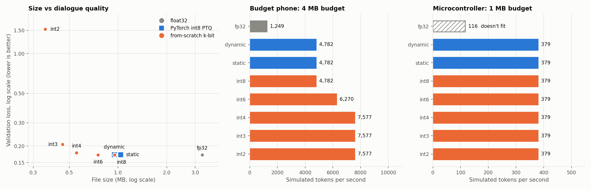

# Quantized Game Dialogue Simulator

A command-line tool for game developers. It trains a **small GPT, written from scratch**,
to voice the non-player characters (NPCs) of a fantasy town. It then **quantizes** that model
and measures what changes: the **file size**, the **dialogue quality**, and the **generation
speed**. Speed is both measured on your machine and **simulated for resource-constrained devices**:
a handheld console, a budget phone, and a microcontroller.

No pretrained weights, no API key: everything runs on a laptop CPU.

```
$ python -m app.cli talk BARD "Sing about the dragon." --n 2
BARD: Ah, the Goose Who Would Be Knight! Hum along if you know it, weep if you don't.
BARD: For one gold I'll sing the Drowned Bell. For ten silver more, I'll stop.

$ python -m app.cli talk MERCHANT "That's too expensive." --model int4 --n 2
MERCHANT: Too expensive? I crossed the north road to bring you a lucky charm! two gold, final offer.
MERCHANT: For a friend, eight silver. Do not tell the others.
```

The second command uses the 4-bit model, which is 0.55 MB instead of 3.3 MB.

## Results at a glance

| Variant | How | File size | Smaller by | Held-out loss | Greedy reply = float model's | Real words |
|---|---|---|---|---|---|---|
| **fp32** | float32 baseline | 3.315 MB | 1.0x | 0.1710 | 100% | 99.9% |
| **dynamic** | PyTorch dynamic PTQ, int8 weights | 0.949 MB | 3.49x | 0.1720 | 75% | 99.8% |
| **static** | PyTorch static PTQ, int8 weights + activations | 1.040 MB | 3.19x | 0.1719 | 55% | 99.8% |
| **int8** | from-scratch 8-bit, per-row scale | 0.951 MB | 3.49x | 0.1711 | 95% | 99.9% |
| **int6** | from-scratch 6-bit | 0.752 MB | 4.41x | 0.1714 | 60% | 99.8% |
| **int4** | from-scratch 4-bit | 0.554 MB | 5.98x | 0.1774 | 40% | 99.8% |
| **int3** | from-scratch 3-bit | 0.455 MB | 7.29x | 0.2061 | 5% | 97.4% |
| **int2** | from-scratch 2-bit | 0.355 MB | 9.32x | 1.5360 | 0% | 27.1% |



- **8-bit is free.** Every int8 variant shrinks the model 3.2–3.5x and leaves the held-out
  loss within 0.001 of float32. Replies stay fluent and in character.
- **4-bit is the sweet spot for size.** At 6x smaller, loss rises by only 0.006. Replies
  change wording (only 40% are identical to the float model's) but remain good dialogue.
- **3-bit starts to break, and 2-bit collapses.** At 3 bits typos appear ("old mins",
  "bbargain") and characters lose track of their topic. At 2 bits the output is gibberish
  ("Bandin olt thasedille hase...", 27% real words).
- **Simulated budget phone (4 MB budget):** a 60-character reply takes 48 ms in float32 and
  12.5 ms in int8. Decoding there is memory-bound, so reading 4x fewer bytes makes it 3.8x faster.
- **Simulated microcontroller (1 MB):** the float32 model **does not fit**. Every quantized
  variant fits and runs at about 380 characters/s. Below 8 bits there is no further speed gain,
  because the device is compute-bound: weights are unpacked to int8 before the multiply.
- **On this laptop, int8 is *not* faster for generation** (0.8x). With 128-wide layers,
  quantizing each activation costs more than the int8 matrix multiply saves, and the 3.3 MB
  float model already fits in the CPU cache. int8 does win 1.3–1.6x on full-context passes
  through the larger layers. Quantization pays off on devices that are short of memory or
  bandwidth, which this laptop isn't. That is why the device simulation is part of the project.

Full tables (every layer, every device) are in [reports/quantization.md](reports/quantization.md).
Side-by-side replies from all 8 variants for 20 prompts, with the same seeds, are in
[reports/samples.md](reports/samples.md).

## Run it

You need Python 3.12 and git.

```bash
python3.12 -m venv .venv && source .venv/bin/activate     # Windows: .venv\Scripts\activate
pip install -r requirements.txt
cp .env.example .env            # optional: MODEL_DIR, TORCH_THREADS
```

```bash
python -m app.cli build-corpus          # data/corpus.txt (already committed; rebuild after editing templates)
python -m app.cli train                 # 824K-parameter GPT, 3,000 steps -> models/gpt_fp32.pt (~25-35 min on CPU)
python -m app.cli train --steps 600     # quicker, rougher model for a first try

python -m app.cli talk GUARD "Is the road safe?" --n 3       # three sampled replies
python -m app.cli talk                                        # interactive: pick an NPC and chat
python -m app.cli talk HEALER "I'm hurt." --model int4        # any variant: fp32, dynamic, static, int8..int2

python -m app.cli quantize              # build every variant -> models/variants/, print file sizes
python -m app.cli simulate              # simulated latency and memory fit per device
TORCH_THREADS=1 python -m app.cli report  # everything -> reports/ (a few minutes)
```

`talk` options: `--temperature` (0 means greedy), `--top-k`, `--seed`, `--n`.

Tests: `pytest`, 37 tests in about a minute. They train a tiny model in seconds, so they
need no `models/` folder. CI runs them on every push.

## How it works

### 1. Corpus (`data/`, `app/corpus.py`, `app/core.py`)

Emberfall is an original market town with eight NPC roles, each with its own topics and voice:
blacksmith (gruff), innkeeper, guard, merchant (haggles), healer, bard (jokes), elder (quest
giver), and ferryman. Each exchange in the corpus is two lines:

```
PLAYER: Can you fix my sword?
BLACKSMITH: That edge is chewed like a goblin's bone. Leave it till dusk, ten silver.
```

The corpus combines 35 hand-written seed exchanges (`data/raw/seed_dialogue.txt`) with a seeded
template generator. The generator has 3–4 intents per role, each with several player wordings
and NPC replies, filled with slot values such as items, places, monsters and prices.
Preprocessing normalises text to ASCII, collapses whitespace, strips unexpected characters, drops
malformed, over-long, unknown-role or duplicate exchanges. The result: **2,867 exchanges,
334K characters, a 57-character vocabulary.**

The validation set is 10% of exchanges, held out whole, so no exchange is split between training
and validation. The tokenizer is one token per character, which keeps the embedding table to
57 × 128.

The first generated corpus had template bugs that the trained model faithfully reproduced:
"in the a storm", "a troll were seen", "a axe". I fixed the templates, added checks, and
retrained.

### 2. GPT from scratch (`app/model.py`, `app/train.py`)

| | |
|---|---|
| Layers / heads / width | 4 / 4 / 128 |
| Context | 128 characters |
| Parameters | 824,320 (96% of them in Linear weights) |
| Attention | Hand-written masked multi-head attention. A test checks that changing future tokens never changes past logits. |
| Block | pre-LayerNorm, attention + 4x GELU MLP, residuals, dropout 0.1 |
| Training | AdamW (betas 0.9/0.95, weight decay on matrices only), warm-up + cosine LR, gradient clipping, batch 32, 3,000 steps |
| Result | Held-out loss 4.06 → **0.171** (perplexity 1.19 per character), 26 min on CPU |

Every learned projection is an `nn.Linear` inside a `LinearSlot` (QuantStub → Linear →
DeQuantStub). In the float model the stubs do nothing. They are what makes eager-mode *static*
quantization possible on a model whose softmax and LayerNorm have no int8 kernels.

### 3. Generation (`app/llm.py`)

The prompt is `PLAYER: <line>\n<ROLE>:`. The model samples characters (temperature, top-k)
until it writes a newline, the end of the NPC's line. Seeds make it repeatable.

### 4–5. Quantization and size (`app/quantize.py`)

- **Dynamic PTQ** (`quantize_dynamic`): Linear weights are stored as int8. Activations are
  quantized on the fly from their runtime range, so no calibration is needed.
- **Static PTQ** (`prepare` → calibrate → `convert`): int8 weights *and* int8 activations at
  each Linear input. Activation scales are fixed in advance by running 64 windows of training
  text through observers.
- **From-scratch k-bit (8/6/4/3/2):** asymmetric affine quantization with one scale and zero
  point per output row (`w ≈ (q − z)·s`). The codes are bit-packed, so two 4-bit codes share a
  byte, and scales are stored as float16. Quality is measured on the dequantized weights, and
  the file on disk holds exactly those values (a test checks this).

Sizes are the measured bytes of each saved file. One gotcha: `torch.save` stores raw `bytes`
as latin-1 text, which inflated my packed files by 1.5x until I switched to `uint8` tensors.
Embeddings, biases and LayerNorms (0.12 MB) stay float32 in every variant. That is the floor:
even 1-bit weights couldn't go below it.

### 6. Speed (`app/simulate.py`)

1. **Operations on float vs quantized weights:** the median time of `y = xWᵀ + b` for each of
   the model's 5 Linear shapes, with fp32, dynamic int8 and static int8 kernels, at decode size
   (1 token) and prefill size (128 tokens).
2. **Whole replies:** tokens/s for greedy 60-character replies on this CPU. The committed
   numbers use 1 thread, closer to a small device than this laptop's 14.
3. **Device simulation:** a roofline estimate per generated token:
   `max(bytes read ÷ bandwidth, ops ÷ throughput)`. Every weight is read once per token, at
   2 operations per weight. int8 throughput applies to weights of 8 bits or fewer, plus float
   attention. The three device profiles are **assumptions**, not measurements; change them in
   `DEVICES`:

| Device | Bandwidth | fp32 | int8 | Budget for the model |
|---|---|---|---|---|
| Handheld console | 25 GB/s | 40 GFLOP/s | 160 GOP/s | 16 MB |
| Budget phone (little core) | 4 GB/s | 4 GFLOP/s | 16 GOP/s | 4 MB |
| Microcontroller (Cortex-M7 class) | 0.4 GB/s | 0.2 GFLOP/s | 0.8 GOP/s | 1 MB |

The simulator counts model bytes from parameter counts (for example 0.93 MB for int8). That is
slightly below the file sizes above, which include file-format overhead.

## Limitations

- **The corpus is mostly templated**, so the model is good at Emberfall-style replies and
  weak on anything else. Unfamiliar questions get a plausible reply for that role, but not
  always one that answers the question. For example, "Why are there so many soldiers today?"
  gets "We lost a patrol near the river crossing in the sleet." On unfamiliar wordings it
  sometimes borrows another role's line: the merchant once said the blacksmith's "The forge
  doesn't haggle".
- The generator fills the player's line and the reply independently, so a few exchanges don't
  match: "How much for this shield?" can get "For this sword? ...".
- Prices after a full stop are not capitalised ("...a silver mirror. two gold, a bargain."),
  because the generator only capitalises the start of each line.
- The speed comparison on real int8 kernels covers PyTorch's x86 backend only. The k-bit
  variants have no packed kernels here, so their speed is simulated only.
- The device profiles are illustrative. Plug in your target hardware's real bandwidth and
  throughput before relying on the numbers.

## Project layout

```
app/corpus.py     seed + template generator, cleaning, de-duplication
app/core.py       exchange format, prompt, character tokenizer, train/val split
app/model.py      GPT from scratch, LinearSlot, sampling
app/train.py      training loop, deterministic validation loss, checkpoint
app/llm.py        load checkpoint, NPC replies
app/quantize.py   dynamic / static PTQ, k-bit quantizer + bit packing, size measurement
app/simulate.py   op + generation timing, device roofline simulation
app/report.py     runs everything, writes reports/ and the chart
app/cli.py        build-corpus, train, talk, quantize, simulate, report
data/             seed dialogue and the generated corpus
reports/          quantization.md, samples.md, results.json, tradeoff.png, train_history.json
models/           checkpoint and quantized variants (git-ignored)
```
