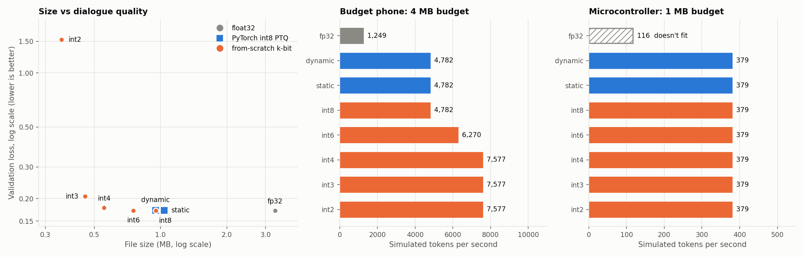

# Quantization report

Model: 824,320 parameters (4 layers, d=128, context 128, 57-character vocabulary). Timings on this machine used 1 CPU threads.

## Size and quality

| Variant | Method | File size | Smaller by | Val loss | Δ loss | Perplexity | Greedy = fp32 | Real words |
|---|---|---|---|---|---|---|---|---|
| **fp32** | float32 baseline | 3.315 MB | 1.0x | 0.1710 | +0.0000 | 1.187 | 100% | 99.9% |
| **dynamic** | PyTorch dynamic PTQ, int8 weights | 0.949 MB | 3.49x | 0.1720 | +0.0010 | 1.188 | 75% | 99.8% |
| **static** | PyTorch static PTQ, int8 weights + activations | 1.040 MB | 3.19x | 0.1719 | +0.0009 | 1.188 | 55% | 99.8% |
| **int8** | from-scratch 8-bit weights, per-row scale | 0.951 MB | 3.49x | 0.1711 | +0.0001 | 1.187 | 95% | 99.9% |
| **int6** | from-scratch 6-bit weights, per-row scale | 0.752 MB | 4.41x | 0.1714 | +0.0004 | 1.187 | 60% | 99.8% |
| **int4** | from-scratch 4-bit weights, per-row scale | 0.554 MB | 5.98x | 0.1774 | +0.0064 | 1.194 | 40% | 99.8% |
| **int3** | from-scratch 3-bit weights, per-row scale | 0.455 MB | 7.29x | 0.2061 | +0.0351 | 1.229 | 5% | 97.4% |
| **int2** | from-scratch 2-bit weights, per-row scale | 0.355 MB | 9.32x | 1.5360 | +1.3650 | 4.646 | 0% | 27.1% |

*Val loss*: next-character cross-entropy on held-out dialogue (lower is better). *Greedy = fp32*: share of the 20 test prompts where the greedy reply is character-for-character the float model's. *Real words*: share of generated words that occur in the corpus.

Where the float32 bytes are: Linear weights 3.175 MB (96%), biases 0.018 MB, embeddings 0.095 MB, LayerNorms 0.009 MB. Only Linear weights are quantized, so even 1-bit weights could not go below 0.122 MB.

## Operations on float vs quantized weights (this CPU)

Median time of one `y = x Wᵀ + b` per Linear shape. *Decode* = 1 token (what each generated character costs), *prefill* = a full context window.

| Layer | Shape | Per model | Tokens | fp32 | dynamic int8 | static int8 | dynamic speed-up | static speed-up |
|---|---|---|---|---|---|---|---|---|
| attn.qkv | 128→384 | 4 | 1 | 33.2 µs | 72.5 µs | 94.0 µs | 0.46x | 0.35x |
| attn.qkv | 128→384 | 4 | 128 | 258.6 µs | 329.7 µs | 394.8 µs | 0.78x | 0.65x |
| attn.proj | 128→128 | 4 | 1 | 33.2 µs | 68.9 µs | 80.0 µs | 0.48x | 0.42x |
| attn.proj | 128→128 | 4 | 128 | 156.6 µs | 115.9 µs | 211.6 µs | 1.35x | 0.74x |
| mlp.fc | 128→512 | 4 | 1 | 37.4 µs | 78.9 µs | 115.3 µs | 0.47x | 0.32x |
| mlp.fc | 128→512 | 4 | 128 | 342.8 µs | 225.6 µs | 237.0 µs | 1.52x | 1.45x |
| mlp.proj | 512→128 | 4 | 1 | 33.4 µs | 46.1 µs | 61.6 µs | 0.73x | 0.54x |
| mlp.proj | 512→128 | 4 | 128 | 241.5 µs | 148.0 µs | 179.8 µs | 1.63x | 1.34x |
| head | 128→57 | 1 | 1 | 15.9 µs | 47.1 µs | 62.2 µs | 0.34x | 0.26x |
| head | 128→57 | 1 | 128 | 49.8 µs | 55.9 µs | 76.9 µs | 0.89x | 0.65x |

Whole replies (greedy, 60 characters each, 8 prompts, batch 1):

| Variant | Tokens/s | ms per token | vs fp32 |
|---|---|---|---|
| fp32 | 183.9 | 5.439 | 1.00x |
| dynamic | 149.4 | 6.695 | 0.81x |
| static | 146.6 | 6.822 | 0.80x |

## Simulated devices

Roofline estimate per generated token: max(bytes read ÷ bandwidth, operations ÷ throughput), int8 throughput for ≤8-bit weights. Device figures are assumptions (edit `DEVICES` in `app/simulate.py`):

| Device | Bandwidth | fp32 | int8 | Model budget | Notes |
|---|---|---|---|---|---|
| Handheld console | 25.0 GB/s | 40.0 GFLOP/s | 160.0 GOP/s | 16.0 MB | mid-range mobile SoC, a few cores spared from rendering |
| Budget phone (little core) | 4.0 GB/s | 4.0 GFLOP/s | 16.0 GOP/s | 4.0 MB | one efficiency core, model kept small so the game has the RAM |
| Microcontroller (Cortex-M7 class) | 0.4 GB/s | 0.2 GFLOP/s | 0.8 GOP/s | 1.0 MB | e.g. a smart toy or e-reader; ~1 MB usable for the model |

**Handheld console**

| Variant | Model size | Fits | ms/token | Tokens/s | 60-char reply | Bound by |
|---|---|---|---|---|---|---|
| fp32 | 3.297 MB | yes | 0.1281 | 7,803.8 | 7.7 ms | memory |
| dynamic | 0.93 MB | yes | 0.0335 | 29,890.2 | 2.0 ms | memory |
| static | 0.93 MB | yes | 0.0335 | 29,890.2 | 2.0 ms | memory |
| int8 | 0.93 MB | yes | 0.0335 | 29,890.2 | 2.0 ms | memory |
| int6 | 0.732 MB | yes | 0.0255 | 39,187.2 | 1.5 ms | memory |
| int4 | 0.533 MB | yes | 0.0176 | 56,878.8 | 1.1 ms | memory |
| int3 | 0.434 MB | yes | 0.0136 | 73,461.4 | 0.8 ms | memory |
| int2 | 0.335 MB | yes | 0.0132 | 75,766.8 | 0.8 ms | compute |

**Budget phone (little core)**

| Variant | Model size | Fits | ms/token | Tokens/s | 60-char reply | Bound by |
|---|---|---|---|---|---|---|
| fp32 | 3.297 MB | yes | 0.8009 | 1,248.6 | 48.1 ms | memory |
| dynamic | 0.93 MB | yes | 0.2091 | 4,782.4 | 12.5 ms | memory |
| static | 0.93 MB | yes | 0.2091 | 4,782.4 | 12.5 ms | memory |
| int8 | 0.93 MB | yes | 0.2091 | 4,782.4 | 12.5 ms | memory |
| int6 | 0.732 MB | yes | 0.1595 | 6,270.0 | 9.6 ms | memory |
| int4 | 0.533 MB | yes | 0.132 | 7,576.7 | 7.9 ms | compute |
| int3 | 0.434 MB | yes | 0.132 | 7,576.7 | 7.9 ms | compute |
| int2 | 0.335 MB | yes | 0.132 | 7,576.7 | 7.9 ms | compute |

**Microcontroller (Cortex-M7 class)**

| Variant | Model size | Fits | ms/token | Tokens/s | 60-char reply | Bound by |
|---|---|---|---|---|---|---|
| fp32 | 3.297 MB | **no** | 8.5926 | 116.4 | 515.6 ms | compute |
| dynamic | 0.93 MB | yes | 2.6397 | 378.8 | 158.4 ms | compute |
| static | 0.93 MB | yes | 2.6397 | 378.8 | 158.4 ms | compute |
| int8 | 0.93 MB | yes | 2.6397 | 378.8 | 158.4 ms | compute |
| int6 | 0.732 MB | yes | 2.6397 | 378.8 | 158.4 ms | compute |
| int4 | 0.533 MB | yes | 2.6397 | 378.8 | 158.4 ms | compute |
| int3 | 0.434 MB | yes | 2.6397 | 378.8 | 158.4 ms | compute |
| int2 | 0.335 MB | yes | 2.6397 | 378.8 | 158.4 ms | compute |

